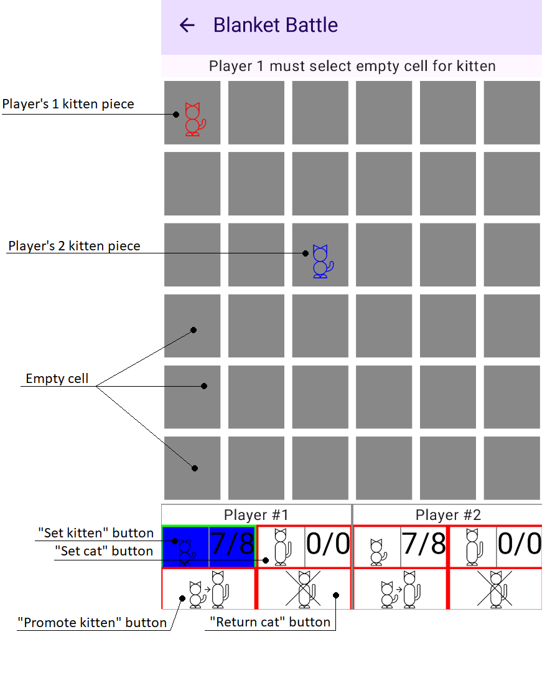
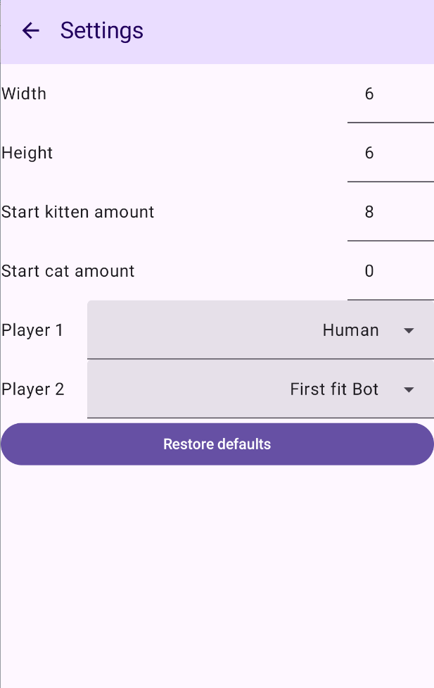

# Blanket Battle

This is my homemade app for "Boop" tabletop game ([link on BGG](https://boardgamegeek.com/boardgame/355433/boop))

Application allows you to play against other person on same device or against bot. Additional settings - board size, piece count - is provided in addition to a standard rules

## Getting Started
### Requirements
* Android Studio (app was created on Panda; previous version may work as well)
* JDK 21 (previous version may work as well)
* Android SDK 24+ on device

### Build from source
1. Clone the repo
2. Open in Android Studio
3. Run `./gradlew assembleDebug`
4. APK will be at `app/build/outputs/apk/debug/app-debug.apk`

### Install
* Build from the source as described above
* Enable "Install from unknown sources" for your file manager
* Open the APK to install

### Start

From start screen you can start new game ("Start Game"), edit settings ("Settings") or close game ("Exit game")

### Playing game

TL;DR: Tic-Tac-Toe with two types of pieces. 3 pieces of first type turn into second type and return to your hand, 3 pieces of second type win game.
New pieces scare old ones, causing them to move one cell away

See also [full Boop rules on BoardGameGeek](https://boardgamegeek.com/filepage/239923/boop-rules-v1)
* Players make moves one by one, starting with first
* During you turn you can put one of your kitten or cat pieces on the empty cell on board
  * Amount of available/max pieces of each type is shown in bottom panel
  * You can select desired piece on bottom panel
  * Selectable actions have green border, currently unusable - red
* Each new piece "boops" existing neighboring pieces on board
  * Booped pieces move one cell away from one that booped them
  * Only 8 neighboring pieces are booped by new arrival
  * If cell, where booped piece wants to move, isn't empty, this piece doesn't move
  * If cell, where booped piece wants to move is outside the board, this piece returns to the owner's hand
  * Pieces get booped no matter what player they belong to
  * Kittens boop kittens, but not cats
  * Cat boop both cats and kittens
  * There is no chain reactions - booped pieces don't make boop themselves
* When a triplet (three pieces of current player form unbroken horizontal, vertical or diagonal line) is formed on board:
  * If all of them are cats, game is over; owner of line wins
  * If some of them are kittens, pieces are removed from board. Cats return to player's hand, kittens are removed from the game with player getting an equal amount of cat in their hand instead
  * If your action creates multiple triplets, you have to select one of them to remove
  * Triplets of inactive player will be processed and removed during their turn
* If all of your pieces are on board, you can spend your turn to remove one of your kittens, getting cat in your hand instead ("Promote kitten" button)
* If all of your pieces are on board, you can spend your turn to remove one of your cats, getting it in your hand ("Return cat" button)

### Settings

* Width - amount of columns in game field
* Height - amount of rows in game field
* Start kitten amount - amount of kitten pieces you start game with
* Start cat amount - amount of cats pieces you start game with
* Player 1 - type of first player (Human or one of bots)
* Player 2 - type of second player (Human or one of bots)
"Restore defaults" button will allow you to restore to standard settings (6x6 field, 8 kittens and 0 cats on start)

## Help
In case of troubleshooting feel free to contact author through the email below

## Author

Ivan.Matkovskii  (ivan.matkovsky@gmail.com)

## Version History

* 1.0.0
  * Initial stable release - working gameplay, two types of bots
* 1.2.2
  * Multiple bug fixes and graphic updates, this readme
  
## License

This is an unofficial, fan-made project. It is not affiliated with, endorsed by, or sponsored by Scott Brady or Smirk and Dagger Games.
Board game "Boop" is created by Scott Brady and published by "Smirk and Dagger". 
All rights to game still belong to its creators and publisher. 
This app is created for non-commercial use only.

## Acknowledgments

If you enjoy this game, I highly recommend checking out the official digital version, "Boop World", published by Smirk & Dagger Games. Supporting the official release is the best way to ensure the game's creators can continue to make great games.
* [Official mobile game](https://play.google.com/store/apps/details?id=com.hashbytestudio.smirkdagger.boop)
* [Smirk And Dagger](https://smirkanddagger.com/)
* [Boop on BoardGameGeek](https://boardgamegeek.com/boardgame/355433/boop)
* [Boop rules on BoardGameGeek](https://boardgamegeek.com/filepage/239923/boop-rules-v1)